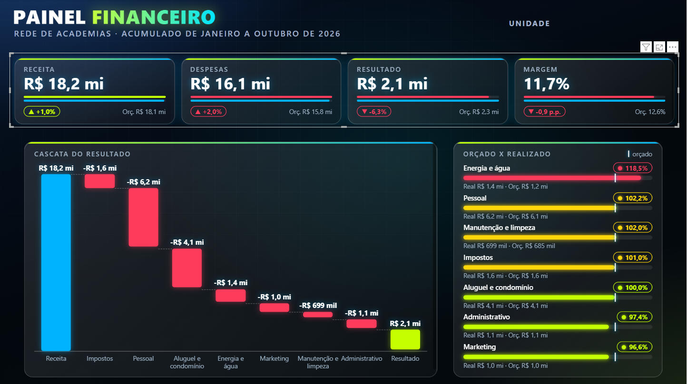
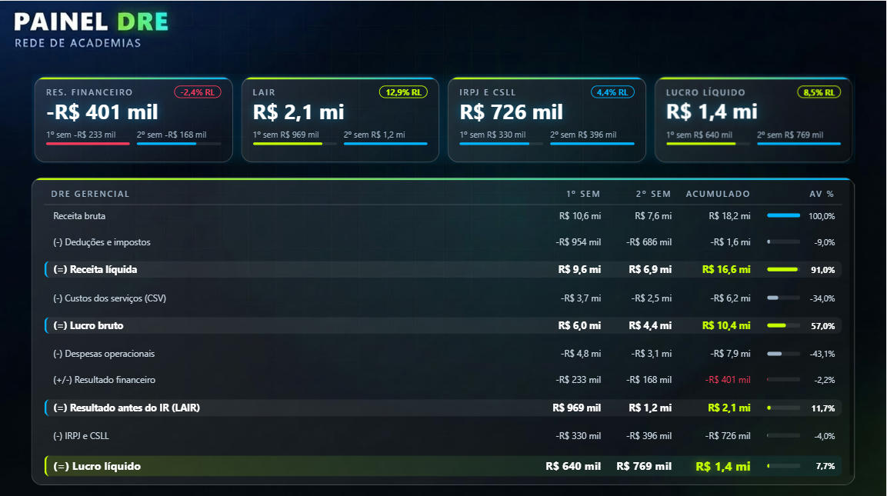

# 📊 Painel Financeiro e DRE · Rede de Academias (Power BI)

Este é um projeto de BI com foco em **gestão financeira no varejo de serviços**. Ele mostra como uma rede de academias acompanha receita, despesas e resultado frente ao orçamento, e traz uma **DRE gerencial** por semestre.

🔗 **Veja o painel online:** `https://SEU-USUARIO.github.io/NOME-DO-REPOSITORIO/`




---

## 🎯 Problema de negócio

A diretoria de uma rede com **6 academias** precisava responder rápido a três perguntas:

1. **Estamos dentro do orçamento?** Por unidade e por grupo de despesa.
2. **Para onde vai o dinheiro?** Do faturamento até o resultado final.
3. **Qual é o lucro real?** Pela estrutura contábil da DRE, comparando o 1º e o 2º semestre.

## 🗂️ Base de dados

O arquivo é `dados/Base_Financeiro_Academias.xlsx`, com dados fictícios de janeiro a outubro de 2026.

| Tabela | Tipo | Conteúdo |
|---|---|---|
| fLancamentos | Fato | 3.621 lançamentos (Data, Unidade, Conta, Valor) |
| fOrcamento | Fato | 1.008 linhas de orçamento mensal |
| dContas | Dimensão | 17 contas com Grupo, Tipo (Receita/Dedução/Despesa) e Ordem DRE |
| dUnidades | Dimensão | 6 unidades (cidade, UF, inauguração, área) |
| dCalendario | Dimensão | Calendário em DAX. Há também uma versão em Python em `python/dCalendario.py` |

## 🔗 Modelagem

O modelo segue o **esquema estrela**. São 6 relações 1:N com filtro em direção única:

- fLancamentos → dContas, dUnidades, dCalendario
- fOrcamento → dContas, dUnidades, dCalendario

## 🧮 Medidas DAX principais

Todas ficam na tabela `_Medidas`. Os scripts completos, em TMDL, estão na pasta `dax/`.

```DAX
Receita   = CALCULATE(SUM(fLancamentos[Valor]), dContas[Tipo] = "Receita")
Despesas  = CALCULATE(SUM(fLancamentos[Valor]), dContas[Tipo] <> "Receita")
Resultado = [Receita] - [Despesas]
Margem %  = DIVIDE([Resultado], [Receita])
```

Cada uma tem a versão **orçada**, que usa `fOrcamento[Valor Orçado]`.

## 📑 Lógica da DRE

| Linha | Cálculo |
|---|---|
| Receita bruta | Contas do Tipo "Receita" |
| (−) Deduções | Impostos sobre a receita |
| **(=) Receita líquida** | Receita bruta − Deduções |
| (−) Custos dos serviços (CSV) | Grupo Pessoal (salários e encargos) |
| **(=) Lucro bruto** | Receita líquida − CSV |
| (−) Despesas operacionais | Aluguel, energia, marketing, manutenção e administrativo |
| (+/−) Resultado financeiro | Taxas de cartão |
| **(=) LAIR** | Lucro bruto − Despesas operacionais + Resultado financeiro |
| (−) IRPJ e CSLL | 34% sobre o LAIR positivo (estimativa, com alíquota parametrizável) |
| **(=) Lucro líquido** | LAIR − IRPJ e CSLL |

**Conferência:** o LAIR (R$ 2.133.944,29) bate exatamente com a medida `Resultado`, então nenhum lançamento ficou de fora.

As medidas da DRE ficam organizadas em pastas: `DRE › 1. Linhas da DRE`, `2. Indicadores` e `3. Visuais HTML`.

## 🎨 Visuais em HTML gerados por DAX

Os cartões, a cascata do resultado, o orçado x realizado e a DRE são **medidas DAX que montam HTML e CSS**, exibidas no visual *HTML Content*. Regras usadas:

- Tema escuro com painéis de vidro e destaques neon em verde-limão e azul elétrico, com animação ao carregar.
- Verde = bom e vermelho = ruim. Nas despesas a lógica se inverte.
- Semáforo do orçado: ≤ 100% verde, ≤ 105% amarelo, acima disso vermelho.
- Sem JavaScript e sem recursos externos. Valores no padrão brasileiro (R$ 18,2 mi).

## 📈 Principais números (acumulado jan a out)

- Receita: **R$ 18,2 mi** (+1,0% vs. orçado)
- Resultado: **R$ 2,1 mi**, margem de **11,7%**
- Lucro líquido estimado: **R$ 1,4 mi** (8,5% da receita líquida)
- **Tatuapé** é a única unidade com resultado negativo e pede plano de ação.
- **Energia e água** é o grupo que mais estourou o orçamento (118,5%).

## 🛠️ Como abrir

1. Baixe o arquivo `.pbix` deste repositório.
2. Abra no **Power BI Desktop**, que é gratuito.
3. Se pedir, aponte a fonte de dados para `dados/Base_Financeiro_Academias.xlsx`.

## 📁 Estrutura

```
├── Relatorio_Financeiro_Academias.pbix
├── dados/      → planilha base
├── dax/        → scripts TMDL das medidas
├── python/     → calendário em Python
├── imagens/    → prints do relatório
└── docs/       → site do painel (GitHub Pages)
```

---

**Autor(a):** _seu nome_ · [LinkedIn](https://www.linkedin.com/in/seu-perfil)
